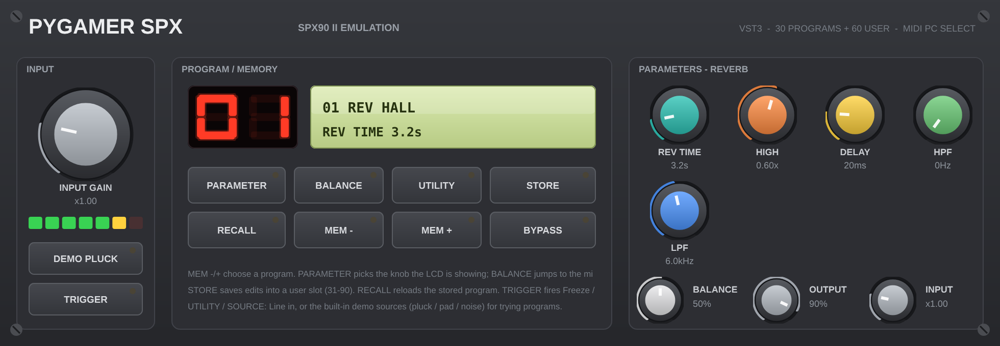

# PyGamer SPX — VST3

The Yamaha SPX90 II emulation from the PyGamer firmware
([pygamer-spx](../pygamer-spx)) as a **VST3 plug-in** for Ableton Live
and any other VST3 host. Same DSP core, same 30 ROM programs + 60 user
memories, same parameter system — now running at your DAW's sample
rate, with a front panel that looks like the hardware.

**Formats: VST3 only.** (That is the current VST standard — Steinberg
discontinued the VST2 SDK, and this project ships no AU/CLAP/
standalone. The extra executables in `tools/` are build-time
validation/screenshot harnesses, not plug-ins.)



## Getting it into Ableton (Intel Mac, Monterey)

The plug-in must be compiled on a Mac — this project was developed
and validated on Linux, and **the macOS build is untested on real
hardware** (no Mac on the build machine). The script is defensive and
stops with a plain-English fix if something's missing:

```sh
./build_macos.sh            # Intel x86_64 (your MacBook)
# ARCH=universal ./build_macos.sh   # if you ever need arm64 too
```

It checks for Xcode Command Line Tools + CMake, clones JUCE 7.0.12
(first run, needs internet), builds Release, installs
`PyGamer SPX.vst3` into `~/Library/Audio/Plug-Ins/VST3`, strips the
quarantine attribute, and prints these rescan steps:

1. Ableton Live → Preferences (Cmd+,) → Plug-Ins
2. **Use VST3 Plug-In System Folders = On**
3. **Rescan** (Option+click Rescan for a deep rescan)
4. Find **PyGamer SPX** under Plug-Ins → VST3 → PyGamerSPX

Live 10.1+ supports VST3. On Linux instead: `./build_linux.sh` builds
the same source and drops the bundle in `dist-linux/` (a prebuilt
Linux bundle is included there; it will not load on macOS).

## The panel — every control, labelled

Fixed size 980×340, drawn to look like the SPX90 II front panel:
1U rack face, corner screws, membrane buttons, a red seven-segment
program number, a backlit LCD, and chunky modular-style knobs with
coloured caps in the parameter section. Nothing is hidden behind
menus or gestures.

**INPUT section (left)**
- **INPUT GAIN knob** — core input gain, 0.1×–4×
- **7-LED meter** — input level, green/yellow/red, like the original
- **SOURCE button** — Line in, or the firmware's built-in demo
  sources (DEMO PLUCK / DEMO PAD / DEMO NOISE) so you can audition
  programs with no input connected; the button shows the current source
- **TRIGGER button** — fires Freeze capture / Triggered Pan, like the
  front-panel/footswitch trigger; its LED lights while a Freeze loop plays

**PROGRAM / MEMORY section (centre)**
- **Red seven-segment display** — current program number (1–90)
- **LCD** — line 1: program number + name; line 2: the parameter the
  LCD is "looking at" and its value, in the original's units
- **PARAMETER** — cycles which of the 8 knobs the LCD is showing
- **BALANCE** — points the LCD at the wet/dry balance
- **UTILITY** — cycles the input source (same as SOURCE)
- **STORE** — saves the edited program into a user slot (31–90; edits
  made on a ROM program land in slot 31 and the display follows)
- **RECALL** — reloads the stored program, discarding edits
- **MEM − / MEM +** — step through programs 1–90
- **BYPASS** — true dry bypass; LED lights while bypassed

**PARAMETERS section (right)**
- **8 coloured knobs** — the current program's parameters, each with
  its real name and formatted value underneath (REV TIME in seconds,
  DLY in ms, PITCH in semitones/cents, modes as named choices, …).
  Turning a knob also points the LCD at it. Programs have 3–8 real
  parameters; unused knob positions hide.
- **Bottom strip: BALANCE** (per-program wet/dry, stored with the
  program like the original), **OUTPUT** level, and a second small
  **INPUT** gain knob (same control as the big one — they track).

**Host automation parameters:** Program (stepped 1–90), Param 1–8
(normalised, mapped through each algorithm's descriptor table —
ranges/steps/mode-detents applied in the processor), Balance, Input
Gain, Output Level, Source, Bypass. MIDI in: program change 0–89 →
programs 1–90, note-on retunes PITCH programs / triggers Freeze &
Pan, CC7 = output level, CC91 = balance — the firmware's map, via the
core's own byte parser. Full state (all parameters + all 60 user
memories + your in-progress edit) is saved in the DAW session.

**Signal path:** stereo in is summed to mono — the hardware has a
single input jack — processed, and rendered to stereo out, exactly
like the original. Programs whose edit you change while a program
change lands in the same instant keep your edit (host edits win over
incoming defaults).

## Sample-rate approach

The firmware core is hard-wired to 31,250 Hz. For the plug-in, the
core was adapted (in `Source/SpxCore.h`, a plugin-only copy — the
firmware is untouched):

- `SPX_SR` became a runtime value set from the host in
  `spx_set_sample_rate()` (44.1 / 48 / 88.2 / 96 kHz all fine). Every
  time-derived constant in the core was already computed from the
  rate, so retiming is exact, not approximate.
- The reverb tank lengths and pitch-shift window scale linearly with
  rate; the three hard-coded one-pole coefficients (DC blocker,
  12 kHz wet-path bandwidth, meter decay) are re-poled to keep their
  time constants. Buffers are sized for 96 kHz worst case (the delay
  line keeps its full 1.44 s).
- **Validation** (`tools/run_dsp_validation.sh`, full log in
  `validation_output.txt`): at 31,250 Hz the adapted core's 12-second
  demo render is **bit-identical** to the original firmware core's
  (750,000 samples, max diff 0 LSB, correlation 1.00000000), and
  28/30 preset tables match exactly. The two EARLY REF programs
  differ slightly (≤2% RMS) for one documented reason: their liveness
  regeneration tap reads a modulation-line delay that the firmware
  clamps at 2048 samples (65 ms) because of PyGamer RAM; with desktop
  RAM the plug-in reads it at its programmed delay instead.
- The sanity suite (all 30 presets stable/audible/decaying, reverb
  and echo decay, pitch +12/−12 accuracy, freeze looping, bypass)
  passes **14/14 at 31,250, 44,100, 48,000 and 96,000 Hz**. Through
  the built VST3 at 48 kHz, pitch +12 measured **879.4 Hz** on a
  440 Hz tone.
- Rates above 96 kHz work, with the reverb tank scale clamped (decay
  times stay correct; modal density stops growing) and the delay
  line capped by its buffer (~0.77 s at 192 kHz).

## Validation on Linux (what was actually run)

- Linux VST3 built with JUCE 7.0.12 / CMake, then loaded through
  JUCE's plug-in host scanner in `tools/PluginHarness.cpp`:
  **16/16 checks pass** — instantiates, editor creates (980×340),
  silence → silence, REV HALL impulse tail present and decaying,
  pitch program shifts 440 → 879.4 Hz at 48 kHz, and a state
  round-trip test where a restored instance reproduces a live-set
  instance's impulse response to within 1.4e-5 (echo at the saved
  434 ms delay). Log in `validation_output.txt`.
- `screenshot.png` (1960×680, 2×) and `social.png` (1600×1600) were
  rendered from the real editor by `tools/ScreenshotApp.cpp` under
  Xvfb, with the DEMO PLUCK source running so the meter is lit
  (6/7 LEDs), program 1 REV HALL loaded. Pixel-checked: LCD green,
  seven-segment red, coloured knob caps and meter LEDs all present.

## Honest caveats

- **Parameter-model emulation, not bit-accurate** — same statement as
  the firmware: algorithm structures, program list and parameter
  ranges follow the SPX90 II manual; Yamaha's DSP code was never
  published and none is used.
- **macOS build untested** — written and validated on Linux only;
  `build_macos.sh` has never run on a real Mac. The DSP and GUI code
  are identical and cross-platform JUCE, but budget one
  report-back cycle if CMake/Xcode quarrels.
- The plug-in's editor reads core state for its displays on the
  message thread while audio runs (benign for meters/LCD; knob edits
  go through the host parameter system properly).
- JUCE "Made with JUCE" splash is disabled under the GPL terms below.

## Licensing

This project's own code is released under the **GPLv3**. It is built
on **JUCE 7** (used under its GPLv3 open-source terms — JUCE is
fetched at build time, never vendored here) and the **Steinberg VST3
SDK** as bundled inside JUCE (Steinberg's VST3 licensing applies;
VST3 is a trademark of Steinberg Media Technologies GmbH). "SPX90"
is referenced descriptively only; this is not a Yamaha product and
contains no Yamaha code or data.

## Files

- `Source/` — `PluginProcessor.*` (DSP glue, parameters, MIDI, state),
  `PluginEditor.*` (the hardware panel), `SpxCore.h` (adapted core)
- `build_macos.sh`, `build_linux.sh`
- `tools/` — `dsp_test.cpp` + `run_dsp_validation.sh` (DSP proof),
  `PluginHarness.cpp` (headless VST3 validation), `ScreenshotApp.cpp`
- `dist-linux/PyGamer SPX.vst3` — prebuilt Linux bundle
- `screenshot.png`, `social.png`, `validation_output.txt`
